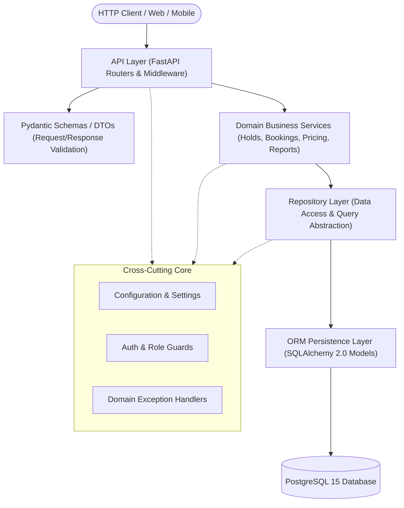
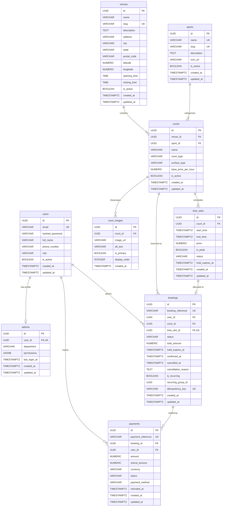

# System Architecture & Technical Design Document (DESIGN.md)

**Project:** Court Booking Service (Production Backend)  
**Version:** 1.0.0  
**Status:** Approved for Implementation  
**Runtime:** Python 3.11 | FastAPI | SQLAlchemy 2.0 (Async) | PostgreSQL 15 | Docker  

---

## 1. Project Overview

The **Court Booking Service** is a high-concurrency, multi-tenant sports facility reservation backend. It enables members to explore venues, sports, and court availability, temporarily hold time slots to prevent race conditions, confirm reservations with guaranteed idempotency, handle recurring bookings, calculate dynamic peak/off-peak pricing, process refunds upon cancellation, and generate weekly utilization analytics for venue administrators.

The system is designed following **Clean Architecture** principles to isolate core business rules from external frameworks, database drivers, and network protocols.

---

## 2. Functional Requirements

### 2.1 Member Experience
* **Venue & Court Discovery:** Browse venues filtered by city, sport, amenities, surface type (indoor/outdoor), and view court images.
* **Real-Time Availability:** Query court slot availability for any date range with peak/off-peak status and dynamic pricing.
* **Temporary Hold Mechanism:** Hold a court slot for 10 minutes (`HELD` state) during checkout. Slots held by other users must be locked to prevent double-booking.
* **Automatic Hold Expiry:** If payment/confirmation is not received within the hold window, the slot reverts to `AVAILABLE` automatically.
* **Booking Confirmation:** Finalize a booking atomically with an idempotent confirmation token and payment capture.
* **Booking Limits:** Enforce a strict ceiling of maximum 3 active future bookings per member.
* **Recurring Bookings:** Reserve weekly recurring time slots for up to 8 consecutive weeks, validating that all slots in the series are conflict-free.
* **Cancellation & Refund Policy:** 
  * Full refund if cancelled $\ge 24$ hours before slot start time.
  * No refund / partial penalty if cancelled $< 24$ hours before slot start time.
  * Time slot is instantly released back to the pool of available inventory upon cancellation.

### 2.2 Administrative & Operational Experience
* **Venue & Court Lifecycle:** Create, update, deactivate, and schedule maintenance blocks for courts and venues.
* **Sport Catalog Management:** Manage supported sports, court surface rules, and default slot durations.
* **Pricing Rules:** Configure base hourly pricing, peak-hour surcharges (e.g., weekdays 18:00–22:00, weekends), and seasonal adjustments.
* **Weekly Utilization Reporting:** Generate aggregated weekly reports detailing total available hours, booked hours, occupancy rate percentage, and revenue generated per court/venue.

---

## 3. Non-Functional Requirements

| Metric / Dimension | Specification | Architecture Strategy |
| :--- | :--- | :--- |
| **Concurrency & Double-Booking** | Zero double bookings tolerated under high concurrency. | Database-level row locking (`SELECT FOR UPDATE`), exclusion constraints, and transactional isolation. |
| **Idempotency** | Prevent duplicate charges or duplicate booking records on network retry. | Unique `idempotency_key` constraint with transactional lookup-or-insert pattern. |
| **Latency (p95)** | Availability lookups $< 80$ms; Booking/Hold checkout $< 150$ms. | B-Tree and Composite indexing on `(court_id, start_time, status)`. |
| **Availability & Fault Tolerance** | 99.9% uptime target. | Stateless FastAPI containers behind load balancers with health probes. |
| **Data Integrity & Consistency** | ACID compliance across holds, bookings, and payments. | Async PostgreSQL transactions; zero out-of-transaction state mutations. |
| **Auditability & Traceability** | Complete historical tracking of payment transactions and status shifts. | Immutable payment logs, timestamps, soft-deletes for courts, and audit fields. |
| **Type Safety & Maintainability** | 100% typed codebase with strict static analysis. | Strict Mypy type-checking, Pydantic V2 schemas, and SQLAlchemy 2.0 mapped types. |

---

## 4. System Architecture

The service adopts **Clean Architecture** (Ports and Adapters / Hexagonal Architecture), structured into four concentric layers:



### Layer Separation
1. **API / Transport Layer (`app/api/`):** HTTP routers, request parameter deserialization, header inspection, status code mapping, and response serialization.
2. **Business Domain Service Layer (`app/services/`):** Pure business logic (e.g., verifying maximum 3 active bookings, calculating 24h refund eligibility, orchestrating hold transitions). Agnostic to HTTP.
3. **Data Access Repository Layer (`app/repositories/`):** Encapsulates raw database queries, joins, filtering, and row-level locking.
4. **Persistence Model Layer (`app/models/`):** SQLAlchemy declarative models representing database relations, constraints, foreign keys, and indexes.
5. **Core & Utilities (`app/core/`):** Global configurations, database connection pools, security tokens, and domain exceptions.

---

## 5. End-to-End Request Flow (Booking Hold & Confirmation)

```mermaid
sequenceDiagram
    autonumber
    actor Member as Member
    participant API as FastAPI Router
    participant Service as BookingService
    participant Repo as BookingRepository
    participant DB as PostgreSQL 15

    Note over Member, DB: Step 1: Temporary Court Hold (10-minute lock)
    Member->>API: POST /api/v1/bookings/holds (court_id, time_slot_id)
    API->>Service: create_hold(user_id, court_id, time_slot_id)
    Service->>Repo: lock_slot_for_hold(time_slot_id)
    Repo->>DB: SELECT * FROM time_slots WHERE id = :id FOR UPDATE
    alt Slot is ALREADY BOOKED or ACTIVE HOLD
        DB-->>Repo: Slot state != AVAILABLE
        Repo-->>Service: SlotUnavailableError
        Service-->>API: Raise HTTP 409 Conflict
        API-->>Member: 409 Slot already held or booked
    else Slot is AVAILABLE or EXPIRED HOLD
        DB-->>Repo: Slot available
        Service->>Repo: Create Booking (status=HELD, hold_expires_at=now()+10m)
        Repo->>DB: INSERT INTO bookings ... ; UPDATE time_slots SET status='HELD'
        DB-->>Repo: Booking created
        Repo-->>Service: Booking entity
        Service-->>API: BookingHoldDTO
        API-->>Member: 201 Created (booking_id, hold_expires_at)
    end

    Note over Member, DB: Step 2: Idempotent Booking Confirmation
    Member->>API: POST /api/v1/bookings/{id}/confirm (Idempotency-Key: UUID)
    API->>Service: confirm_booking(booking_id, idempotency_key, payment_data)
    Service->>Repo: find_by_idempotency_key(idempotency_key)
    alt Request already processed
        Repo-->>Service: Existing confirmed booking
        Service-->>API: Cached BookingResponseDTO
        API-->>Member: 200 OK (Idempotent replay)
    else First-time confirmation
        Service->>Repo: lock_booking_for_update(booking_id)
        Repo->>DB: SELECT * FROM bookings WHERE id = :id FOR UPDATE
        Service->>Service: Validate hold not expired (now < hold_expires_at)
        Service->>Repo: Record Payment(status=SUCCESS)
        Service->>Repo: UPDATE bookings SET status='CONFIRMED'
        Service->>Repo: UPDATE time_slots SET status='BOOKED'
        DB-->>Repo: Commit Transaction
        Repo-->>Service: Confirmed Booking entity
        Service-->>API: BookingResponseDTO
        API-->>Member: 200 OK (Confirmed)
    end
```

---

## 6. Directory Structure & Responsibilities

```text
app/
├── api/
│   ├── dependencies.py      # Dependency injection (DB session, current user, role guards)
│   └── v1/
│       ├── router.py        # Root v1 aggregator
│       ├── auth.py          # Authentication & token endpoints
│       ├── venues.py        # Venue browsing & administration
│       ├── sports.py        # Sport catalog endpoints
│       ├── courts.py        # Court inventory & management
│       ├── availability.py  # Slot availability queries
│       ├── bookings.py      # Hold, confirm, cancel, recurring endpoints
│       ├── payments.py      # Payment history & simulation
│       ├── reports.py       # Admin utilization reports
│       └── admins.py        # Superadmin management
├── core/
│   ├── config.py            # Pydantic Settings & environment variables
│   ├── database.py          # Async SQLAlchemy engine & async sessionmaker
│   ├── exceptions.py        # Custom domain exception classes & error handlers
│   └── security.py          # Password hashing & role definitions
├── models/
│   ├── base.py              # DeclarativeBase, UUIDPrimaryKeyMixin, TimestampMixin
│   ├── enums.py             # Domain Enums (UserRole, BookingStatus, etc.)
│   ├── user.py              # User account entity
│   ├── admin.py             # Admin profile & permissions entity
│   ├── venue.py             # Venue physical facility entity
│   ├── sport.py             # Sport catalog entity
│   ├── court.py             # Court entity
│   ├── court_image.py       # Court gallery image entity
│   ├── time_slot.py         # TimeSlot inventory & lock status
│   ├── booking.py           # Booking transaction entity
│   └── payment.py           # Payment audit & settlement entity
├── repositories/            # SQL query isolation (one repository per aggregate)
├── schemas/                 # Pydantic DTOs for strict input/output validation
└── services/                # Business domain logic & transaction boundaries
```

---

## 7. Key Architecture & Design Decisions

1. **SQLAlchemy 2.0 Async Native Architecture:**
   * Uses `AsyncSession` with `asyncpg` for non-blocking I/O, allowing our application servers to handle thousands of concurrent read queries without thread pool starvation.
2. **Pessimistic Row-Level Locking for Holds (`FOR UPDATE`):**
   * High-contention booking windows (e.g., prime time slots releasing at midnight) create race conditions. We use PostgreSQL `SELECT ... FOR UPDATE` inside an isolated transaction when placing a hold, ensuring only one client acquires the lock.
3. **Idempotency Key Pattern:**
   * Every confirmation request requires an `Idempotency-Key` HTTP header. The database enforces uniqueness on `(user_id, idempotency_key)`, guaranteeing zero double-charging or duplicate bookings during network timeouts or client retries.
4. **UUIDv4 Primary Keys:**
   * All primary keys use `UUIDv4`. This prevents enumeration attacks (e.g., guessing competitor booking volume or other users' booking IDs), facilitates future database sharding, and enables client-generated entity IDs if needed.
5. **UTC-Enforced Timestamps:**
   * All dates and times are stored in PostgreSQL as `TIMESTAMPTZ` (UTC). Facility operating hours are converted with timezone awareness to prevent Daylight Saving Time shifts.

---

## 8. Assumptions

1. **Slot Granularity:** Court bookings occur in discrete 60-minute time slots aligned to the hour (e.g., 09:00–10:00, 10:00–11:00).
2. **Hold Window:** A temporary hold is valid for exactly 10 minutes (600 seconds). If not confirmed, the slot can be acquired by any other user.
3. **Active Booking Definition:** An "active future booking" is any booking in `CONFIRMED` status whose `end_time` is in the future. Once a booking's time elapses, it no longer counts toward the 3-booking cap.
4. **Single Currency:** All prices and payments are denominated in standard decimal units (e.g., USD / INR) with two decimal places.

---

## 9. Open Questions & Future Enhancements

* **Background Cleanup Worker vs Lazy Expiry:** Currently, expired holds are released either dynamically upon next read or when a new hold attempts to acquire them. A dedicated Celery / APScheduler worker can periodically sweep and transition expired holds to `EXPIRED` status.
* **Partial Refund Tiers:** While the current rule is binary ($\ge 24$h = 100% refund; $< 24$h = 0%), future releases may support granular tiers (e.g., 50% refund between 12h–24h).
* **Payment Gateway Integration:** Payment endpoints in this phase act as an asynchronous settlement ledger. In Phase 7/8, mock Stripe/Razorpay webhooks can be plugged in.

---

## 10. PostgreSQL Database Entity Specifications

### 1. `users`
Represents customers, staff, and system administrators.
* `id` (`UUID`, PK, default `gen_random_uuid()`)
* `email` (`VARCHAR(255)`, UNIQUE, NOT NULL, INDEXED)
* `hashed_password` (`VARCHAR(255)`, NOT NULL)
* `full_name` (`VARCHAR(150)`, NOT NULL)
* `phone_number` (`VARCHAR(30)`, NULLABLE)
* `role` (`VARCHAR(20)`, NOT NULL, default `'MEMBER'`) — `MEMBER`, `STAFF`, `ADMIN`
* `is_active` (`BOOLEAN`, NOT NULL, default `TRUE`)
* `created_at` (`TIMESTAMPTZ`, NOT NULL, default `now()`)
* `updated_at` (`TIMESTAMPTZ`, NOT NULL, default `now()`)

### 2. `admins`
Extended administrative profile with role-based access control and audit tracking.
* `id` (`UUID`, PK, default `gen_random_uuid()`)
* `user_id` (`UUID`, FK `users.id` ON DELETE CASCADE, UNIQUE, NOT NULL)
* `department` (`VARCHAR(100)`, NOT NULL)
* `permissions` (`JSONB`, NOT NULL, default `'[]'`)
* `last_login_at` (`TIMESTAMPTZ`, NULLABLE)
* `created_at` (`TIMESTAMPTZ`, NOT NULL, default `now()`)
* `updated_at` (`TIMESTAMPTZ`, NOT NULL, default `now()`)

### 3. `venues`
Physical sports complexes containing one or more courts.
* `id` (`UUID`, PK, default `gen_random_uuid()`)
* `name` (`VARCHAR(150)`, NOT NULL)
* `slug` (`VARCHAR(160)`, UNIQUE, NOT NULL, INDEXED)
* `description` (`TEXT`, NULLABLE)
* `address` (`VARCHAR(255)`, NOT NULL)
* `city` (`VARCHAR(100)`, NOT NULL, INDEXED)
* `state` (`VARCHAR(100)`, NOT NULL)
* `postal_code` (`VARCHAR(20)`, NOT NULL)
* `latitude` (`NUMERIC(9, 6)`, NULLABLE)
* `longitude` (`NUMERIC(9, 6)`, NULLABLE)
* `opening_time` (`TIME`, NOT NULL)
* `closing_time` (`TIME`, NOT NULL)
* `is_active` (`BOOLEAN`, NOT NULL, default `TRUE`)
* `created_at` (`TIMESTAMPTZ`, NOT NULL, default `now()`)
* `updated_at` (`TIMESTAMPTZ`, NOT NULL, default `now()`)

### 4. `sports`
Catalog of supported athletic activities.
* `id` (`UUID`, PK, default `gen_random_uuid()`)
* `name` (`VARCHAR(100)`, UNIQUE, NOT NULL)
* `slug` (`VARCHAR(110)`, UNIQUE, NOT NULL, INDEXED)
* `description` (`TEXT`, NULLABLE)
* `icon_url` (`VARCHAR(500)`, NULLABLE)
* `is_active` (`BOOLEAN`, NOT NULL, default `TRUE`)
* `created_at` (`TIMESTAMPTZ`, NOT NULL, default `now()`)
* `updated_at` (`TIMESTAMPTZ`, NOT NULL, default `now()`)

### 5. `courts`
Individual playing surfaces within a venue dedicated to a sport.
* `id` (`UUID`, PK, default `gen_random_uuid()`)
* `venue_id` (`UUID`, FK `venues.id` ON DELETE CASCADE, NOT NULL, INDEXED)
* `sport_id` (`UUID`, FK `sports.id` ON DELETE RESTRICT, NOT NULL, INDEXED)
* `name` (`VARCHAR(100)`, NOT NULL)
* `court_type` (`VARCHAR(20)`, NOT NULL, default `'INDOOR'`) — `INDOOR`, `OUTDOOR`
* `surface_type` (`VARCHAR(30)`, NOT NULL, default `'HARD'`) — `HARD`, `CLAY`, `GRASS`, `SYNTHETIC`, `WOOD`
* `base_price_per_hour` (`NUMERIC(10, 2)`, NOT NULL)
* `is_active` (`BOOLEAN`, NOT NULL, default `TRUE`)
* `created_at` (`TIMESTAMPTZ`, NOT NULL, default `now()`)
* `updated_at` (`TIMESTAMPTZ`, NOT NULL, default `now()`)
* *Constraint:* `UNIQUE(venue_id, name)`

### 6. `court_images`
Gallery media showcasing courts.
* `id` (`UUID`, PK, default `gen_random_uuid()`)
* `court_id` (`UUID`, FK `courts.id` ON DELETE CASCADE, NOT NULL, INDEXED)
* `image_url` (`VARCHAR(500)`, NOT NULL)
* `alt_text` (`VARCHAR(200)`, NULLABLE)
* `is_primary` (`BOOLEAN`, NOT NULL, default `FALSE`)
* `display_order` (`INTEGER`, NOT NULL, default `0`)
* `created_at` (`TIMESTAMPTZ`, NOT NULL, default `now()`)

### 7. `time_slots`
Inventory of discrete reservable blocks on a court.
* `id` (`UUID`, PK, default `gen_random_uuid()`)
* `court_id` (`UUID`, FK `courts.id` ON DELETE CASCADE, NOT NULL, INDEXED)
* `start_time` (`TIMESTAMPTZ`, NOT NULL)
* `end_time` (`TIMESTAMPTZ`, NOT NULL)
* `price` (`NUMERIC(10, 2)`, NOT NULL)
* `is_peak` (`BOOLEAN`, NOT NULL, default `FALSE`)
* `status` (`VARCHAR(20)`, NOT NULL, default `'AVAILABLE'`) — `AVAILABLE`, `HELD`, `BOOKED`, `BLOCKED`
* `hold_expires_at` (`TIMESTAMPTZ`, NULLABLE)
* `created_at` (`TIMESTAMPTZ`, NOT NULL, default `now()`)
* `updated_at` (`TIMESTAMPTZ`, NOT NULL, default `now()`)
* *Constraints & Indexes:* 
  * `UNIQUE(court_id, start_time)` (Prevents duplicate overlapping slot generation)
  * `INDEX(court_id, start_time, end_time, status)`

### 8. `bookings`
Reservation agreements representing held, confirmed, or cancelled bookings.
* `id` (`UUID`, PK, default `gen_random_uuid()`)
* `booking_reference` (`VARCHAR(32)`, UNIQUE, NOT NULL, INDEXED)
* `user_id` (`UUID`, FK `users.id` ON DELETE RESTRICT, NOT NULL, INDEXED)
* `court_id` (`UUID`, FK `courts.id` ON DELETE RESTRICT, NOT NULL, INDEXED)
* `time_slot_id` (`UUID`, FK `time_slots.id` ON DELETE RESTRICT, UNIQUE, NOT NULL)
* `status` (`VARCHAR(20)`, NOT NULL, default `'HELD'`) — `HELD`, `CONFIRMED`, `CANCELLED`, `COMPLETED`
* `total_amount` (`NUMERIC(10, 2)`, NOT NULL)
* `hold_expires_at` (`TIMESTAMPTZ`, NULLABLE)
* `confirmed_at` (`TIMESTAMPTZ`, NULLABLE)
* `cancelled_at` (`TIMESTAMPTZ`, NULLABLE)
* `cancellation_reason` (`TEXT`, NULLABLE)
* `is_recurring` (`BOOLEAN`, NOT NULL, default `FALSE`)
* `recurring_group_id` (`UUID`, NULLABLE, INDEXED)
* `idempotency_key` (`VARCHAR(64)`, UNIQUE, NULLABLE)
* `created_at` (`TIMESTAMPTZ`, NOT NULL, default `now()`)
* `updated_at` (`TIMESTAMPTZ`, NOT NULL, default `now()`)

### 9. `payments`
Immutable financial transaction ledger capturing payments and refunds.
* `id` (`UUID`, PK, default `gen_random_uuid()`)
* `payment_reference` (`VARCHAR(64)`, UNIQUE, NOT NULL, INDEXED)
* `booking_id` (`UUID`, FK `bookings.id` ON DELETE RESTRICT, NOT NULL, INDEXED)
* `user_id` (`UUID`, FK `users.id` ON DELETE RESTRICT, NOT NULL, INDEXED)
* `amount` (`NUMERIC(10, 2)`, NOT NULL)
* `refund_amount` (`NUMERIC(10, 2)`, NOT NULL, default `0.00`)
* `currency` (`VARCHAR(3)`, NOT NULL, default `'USD'`)
* `status` (`VARCHAR(20)`, NOT NULL, default `'PENDING'`) — `PENDING`, `SUCCESS`, `FAILED`, `REFUNDED`
* `payment_method` (`VARCHAR(30)`, NOT NULL, default `'CREDIT_CARD'`)
* `refunded_at` (`TIMESTAMPTZ`, NULLABLE)
* `created_at` (`TIMESTAMPTZ`, NOT NULL, default `now()`)
* `updated_at` (`TIMESTAMPTZ`, NOT NULL, default `now()`)

---

## 11. Entity-Relationship (ER) Diagram



---

## 12. Complete REST API Specifications

### 12.1 Authentication & User APIs
| Method | Endpoint | Description | Request Body | Response Payload | Status Codes |
| :--- | :--- | :--- | :--- | :--- | :--- |
| `POST` | `/api/v1/auth/register` | Register a new member | `{"email", "password", "full_name", "phone_number"}` | `{"id", "email", "full_name", "role"}` | `201`, `400`, `409` |
| `POST` | `/api/v1/auth/login` | Authenticate & obtain session token | `{"email", "password"}` | `{"access_token", "token_type", "user"}` | `200`, `401` |
| `GET` | `/api/v1/auth/me` | Fetch active user profile | None | `{"id", "email", "full_name", "role", "is_active"}` | `200`, `401` |

### 12.2 Court & Venue Discovery APIs
| Method | Endpoint | Description | Request Body | Response Payload | Status Codes |
| :--- | :--- | :--- | :--- | :--- | :--- |
| `GET` | `/api/v1/venues` | List venues with optional filtering by city | Query params: `city`, `skip`, `limit` | `[{"id", "name", "slug", "city", "opening_time", "closing_time"}]` | `200` |
| `GET` | `/api/v1/venues/{id}` | Get venue details and courts | None | `{"id", "name", "address", "courts": [...]}` | `200`, `404` |
| `GET` | `/api/v1/sports` | List all active sports | None | `[{"id", "name", "slug", "icon_url"}]` | `200` |
| `GET` | `/api/v1/courts` | List courts with filters | Query params: `venue_id`, `sport_id`, `court_type` | `[{"id", "venue_id", "sport_id", "name", "base_price_per_hour", "images": [...]}]` | `200` |
| `GET` | `/api/v1/courts/{id}` | Get single court profile | None | `{"id", "name", "court_type", "surface_type", "base_price_per_hour", "images": [...]}` | `200`, `404` |
| `GET` | `/api/v1/courts/{id}/availability` | Query court slots for a specific date | Query params: `date` (`YYYY-MM-DD`) | `{"date", "court_id", "slots": [{"slot_id", "start_time", "end_time", "price", "is_peak", "status"}]}` | `200`, `404` |

### 12.3 Booking & Hold APIs
| Method | Endpoint | Description | Request Body | Response Payload | Status Codes |
| :--- | :--- | :--- | :--- | :--- | :--- |
| `POST` | `/api/v1/bookings/holds` | Acquire temporary 10-minute hold on a slot | `{"court_id", "time_slot_id"}` | `{"booking_id", "booking_reference", "time_slot_id", "status": "HELD", "hold_expires_at"}` | `201`, `400`, `409` |
| `POST` | `/api/v1/bookings/{id}/confirm` | Idempotently confirm held booking with payment | Header: `Idempotency-Key`<br>`{"payment_method"}` | `{"id", "booking_reference", "status": "CONFIRMED", "total_amount", "confirmed_at"}` | `200`, `400`, `409`, `410` |
| `POST` | `/api/v1/bookings/{id}/cancel` | Cancel booking and compute refund | `{"cancellation_reason"}` | `{"id", "status": "CANCELLED", "refund_amount", "cancelled_at"}` | `200`, `400`, `404` |
| `POST` | `/api/v1/bookings/recurring` | Reserve weekly recurring booking (up to 8 weeks) | `{"court_id", "start_date", "time_slot", "weeks_count"}` | `{"recurring_group_id", "bookings_count", "total_amount", "slots": [...]}` | `201`, `400`, `409` |
| `GET` | `/api/v1/bookings/my` | List current user's active & past bookings | Query params: `status`, `skip`, `limit` | `[{"id", "booking_reference", "court_name", "start_time", "end_time", "status", "total_amount"}]` | `200`, `401` |

### 12.4 Payment APIs
| Method | Endpoint | Description | Request Body | Response Payload | Status Codes |
| :--- | :--- | :--- | :--- | :--- | :--- |
| `GET` | `/api/v1/payments/{id}` | Inspect payment status and refund audit | None | `{"id", "payment_reference", "booking_id", "amount", "refund_amount", "status"}` | `200`, `401`, `404` |
| `GET` | `/api/v1/payments/my` | List logged-in member's payment transactions | Query params: `skip`, `limit` | `[{"id", "payment_reference", "amount", "status", "created_at"}]` | `200`, `401` |

### 12.5 Administrative & Management APIs
| Method | Endpoint | Description | Request Body | Response Payload | Status Codes |
| :--- | :--- | :--- | :--- | :--- | :--- |
| `POST` | `/api/v1/admin/venues` | Create a new venue | `{"name", "slug", "address", "city", "state", "postal_code", "opening_time", "closing_time"}` | `{"id", "name", "slug", "city", "created_at"}` | `201`, `400`, `403` |
| `POST` | `/api/v1/admin/courts` | Create a new court in a venue | `{"venue_id", "sport_id", "name", "court_type", "surface_type", "base_price_per_hour"}` | `{"id", "venue_id", "name", "created_at"}` | `201`, `400`, `403` |
| `POST` | `/api/v1/admin/courts/{id}/slots/generate`| Generate inventory slots for date range | `{"start_date", "end_date", "slot_duration_minutes", "peak_hours": [...]}` | `{"generated_count", "date_range"}` | `201`, `400`, `403` |
| `GET` | `/api/v1/admin/reports/utilization` | Compute weekly utilization report | Query params: `venue_id`, `start_date`, `end_date` | `{"venue_id", "period", "total_hours", "booked_hours", "utilization_rate_pct", "total_revenue"}` | `200`, `403` |

---

