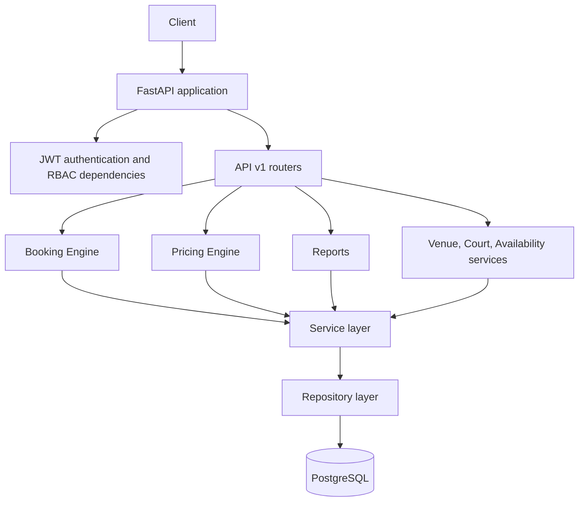
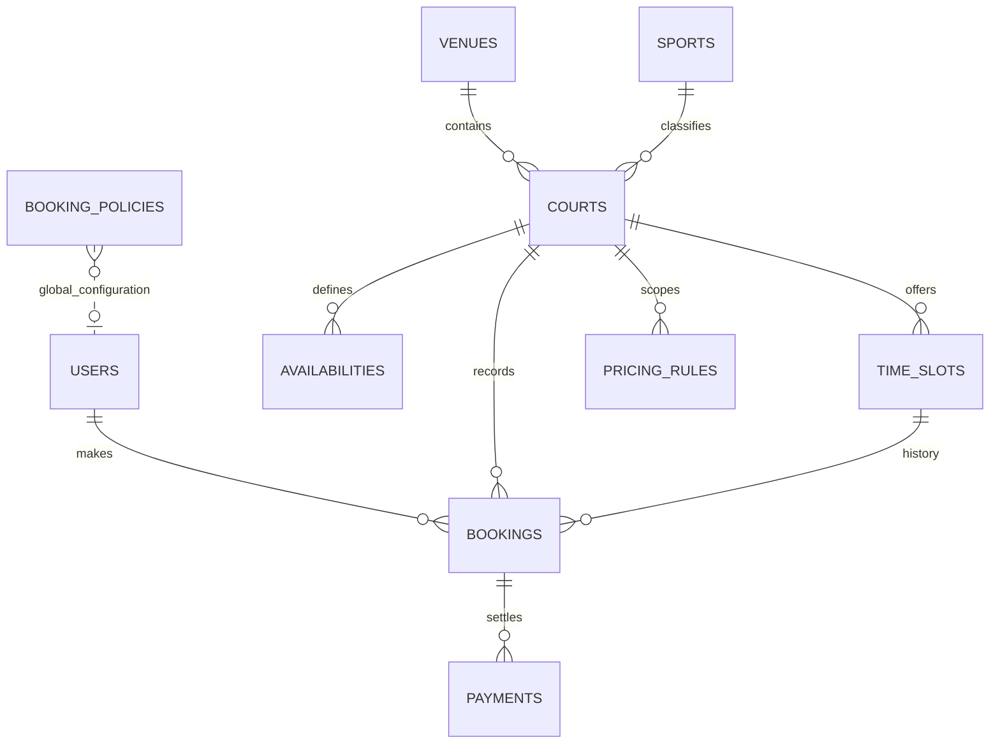
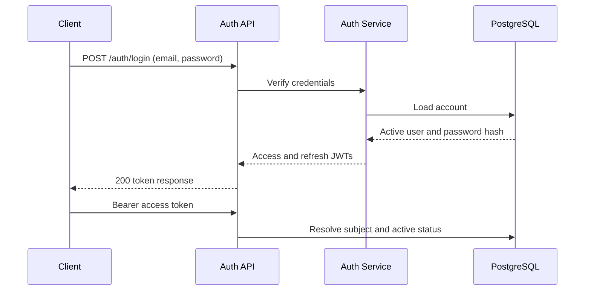
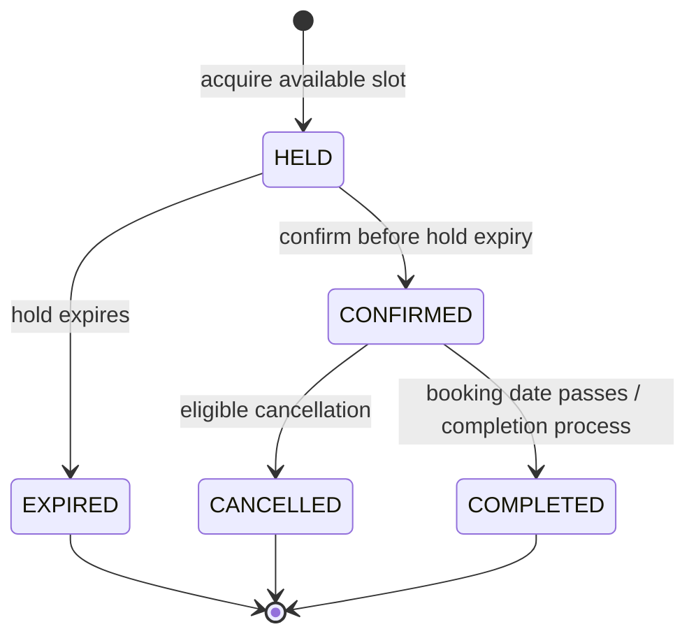

# Court Booking Service


## 1. Project Title

Court Booking Service

## 2. Project Description

Court Booking Service is an asynchronous REST API for managing sports venues,
courts, recurring availability, temporary booking holds, confirmed reservations,
pricing policies, and operational utilization reports. It uses FastAPI,
SQLAlchemy 2.x, PostgreSQL, and Alembic, with a Router → Service → Repository
architecture.

The repository includes authentication, role-based access control, booking
policy validation, a configurable pricing engine, reports, automated tests, and
a production Docker Compose stack.

## 3. Features

- Member registration, login, refresh tokens, and JWT-protected APIs
- Member, staff, and administrator authorization
- Venue, court, sport, and weekly availability management
- Public search for bookable time slots
- Fifteen-minute booking holds, confirmation, cancellation, and recurring
  booking requests
- Dynamic pricing rules for overrides, holidays, peak/off-peak periods,
  weekends, surcharges, discounts, and promotions
- Configurable daily, weekly, future-booking, overlap, and duration limits
- Staff weekly utilization reports with per-court and estimated revenue detail
- PostgreSQL schema migrations and production containers
- GitHub Actions checks for Python imports, migrations, lint, formatting, and
  tests

## 4. Tech Stack

| Area | Technology |
| --- | --- |
| Runtime | Python 3.13 |
| HTTP API | FastAPI, Uvicorn |
| Validation and settings | Pydantic v2, pydantic-settings |
| Persistence | SQLAlchemy 2.x async ORM, asyncpg |
| Database | PostgreSQL 16 in production Compose and CI |
| Schema changes | Alembic |
| Authentication | Signed JWT, bcrypt password hashing |
| Containers | Docker, Docker Compose |
| Quality | Pytest, Ruff |
| CI | GitHub Actions |

## 5. Architecture Overview

```text
Client
  ↓
FastAPI application and middleware
  ↓
Versioned API routers and authentication dependencies
  ↓
Services: Booking Engine · Pricing Engine · Reports · Court Management
  ↓
Repositories: SQLAlchemy queries and persistence
  ↓
PostgreSQL
```



Requests are validated at the API boundary. Routers translate HTTP input and
errors, services coordinate domain rules, and repositories own persistence and
database queries. The database session dependency commits successful requests
and rolls back failures.

## 6. Folder Structure

```text
.
├── .github/workflows/ci.yml       # Python, PostgreSQL, migration, and quality gates
├── alembic/                       # Migration environment and revisions
├── app/
│   ├── api/                        # Authentication dependencies and v1 routers
│   ├── core/                       # Settings, security, exceptions, JSON logging
│   ├── db/                         # Async engine, sessions, metadata registry
│   ├── models/                     # SQLAlchemy entities and enums
│   ├── repositories/               # Database access and aggregations
│   ├── schemas/                    # Pydantic request/response DTOs
│   ├── services/                   # Booking, pricing, policy, report, and court logic
│   └── main.py                     # FastAPI app factory, liveness, lifespan
├── tests/                          # API, unit, transaction, and regression coverage
├── .dockerignore
├── .env.example
├── Dockerfile
├── docker-compose.yml              # Local PostgreSQL service
├── docker-compose.prod.yml         # Production API and PostgreSQL stack
├── entrypoint.sh                   # Database wait, migrations, Uvicorn startup
├── alembic.ini
├── pyproject.toml
├── requirements.txt
├── requirements-dev.txt
└── README.md
```

## 7. Database Design Overview

The database separates venue inventory, recurring availability, generated time
slots, and booking history. UUID primary keys and timestamp columns are shared
across core entities. PostgreSQL constraints, indexes, and row locks support
uniqueness, lookup, and booking lifecycle operations.



The primary tables include `users`, `venues`, `sports`, `courts`,
`availabilities`, `time_slots`, `bookings`, `payments`, `pricing_rules`, and
`booking_policies`. `Booking` rows preserve lifecycle history; cancelled and
expired records are not counted as active for booking limits. Alembic migrations
are the source of truth for schema changes.

## 8. Authentication Flow

1. A member registers with email, password, name, and optional phone number.
2. The service validates and hashes the password before storing the user.
3. Login returns an access token and refresh token.
4. Protected requests send the access token in the `Authorization` header.
5. Refresh requests exchange a valid refresh token for a new token pair.
6. The API resolves the token subject to an active user for protected requests.



Example authorization header:

```http
Authorization: Bearer <access-token>
```

Tokens are signed with the configured secret and algorithm. Do not commit real
secrets or paste live tokens into issues, logs, or documentation.

## 9. Authorization (RBAC)

| Role | Access |
| --- | --- |
| `MEMBER` | Public availability plus own booking creation, listing, confirmation, and cancellation |
| `STAFF` | Member-level access plus pricing, booking policy, and reporting endpoints |
| `ADMIN` | Staff access plus venue, court, and recurring availability administration |

The dependencies `get_current_user`, `require_member`, `require_staff`, and
`require_admin` enforce authentication and role checks. Public availability,
pricing calculation, and health endpoints do not require a bearer token.

## 10. Booking Lifecycle



A hold reserves a slot temporarily. Confirmation is idempotent when the same
idempotency key is reused. Expiration releases the slot. Cancellation is
subject to the existing notice rule and marks eligible payments for refund
handling. Hold expiration is also processed by a background worker.

## 11. Dynamic Pricing Engine

The pricing service starts with a court's hourly base price, loads applicable
rules, orders them by priority, and applies the selected primary rule and any
stackable rules. Rule effects support fixed-price overrides, amount or
percentage surcharges, and discounts. Rules can be scoped by court, date range,
local-time range, and weekdays. The weekly report calls this same pricing
service to estimate revenue rather than implementing separate pricing logic.

## 12. Booking Policy Engine

One active global `BookingPolicy` configures daily, weekly, and future active
booking limits plus minimum and maximum durations. New holds are checked for
duration, overlapping active bookings, and member booking counts. A member row
lock serializes policy checks for concurrent requests. Cancelled and expired
bookings do not count toward active limits.

Staff and administrators can read or replace the active policy at
`/api/v1/booking-policy`.

## 13. Reports Module

`GET /api/v1/reports/weekly-utilization` provides an inclusive date-range report
of up to 31 days. It includes slot counts, booking counts, utilization, daily
breakdown, peak and least-busy days, top and least-utilized courts, and estimated
revenue. The repository performs database aggregation; revenue estimates use
the pricing engine. Only staff and administrators can access reports.

## 14. API Overview

Interactive documentation is available at `/docs`; the OpenAPI schema is
available at `/openapi.json`. Versioned endpoints use the `/api/v1` prefix.

| Method | Path | Access | Success |
| --- | --- | --- | --- |
| `GET` | `/health` | Public | `200` |
| `GET` | `/api/v1/health` | Public | `200` |
| `GET` | `/api/v1/health/db` | Public | `200`, `503` |
| `POST` | `/api/v1/auth/register` | Public | `201` |
| `POST` | `/api/v1/auth/login` | Public | `200` |
| `POST` | `/api/v1/auth/refresh` | Refresh token | `200` |
| `GET` | `/api/v1/auth/me` | Authenticated | `200` |
| `GET` | `/api/v1/availability` | Public | `200` |
| `GET` | `/api/v1/courts/{court_id}/availability` | Public | `200` |
| `POST` | `/api/v1/venues` | Admin | `201` |
| `GET` | `/api/v1/venues` | Authenticated | `200` |
| `GET`, `PATCH`, `DELETE` | `/api/v1/venues/{venue_id}` | Read: authenticated; write: admin | `200`, `204` |
| `POST` | `/api/v1/courts` | Admin | `201` |
| `GET` | `/api/v1/courts` | Authenticated | `200` |
| `GET`, `PATCH`, `DELETE` | `/api/v1/courts/{court_id}` | Read: authenticated; write: admin | `200`, `204` |
| `POST` | `/api/v1/availability` | Admin | `201` |
| `GET` | `/api/v1/availability/windows` | Authenticated | `200` |
| `GET`, `PATCH`, `DELETE` | `/api/v1/availability/{availability_id}` | Read: authenticated; write: admin | `200`, `204` |
| `POST` | `/api/v1/bookings/holds` | Member | `201` |
| `POST` | `/api/v1/bookings/{booking_id}/confirm` | Member | `200` |
| `POST` | `/api/v1/bookings/recurring` | Member | `201` |
| `POST` | `/api/v1/bookings/{booking_id}/cancel` | Member / owner | `200` |
| `GET` | `/api/v1/bookings/my` | Member | `200` |
| `GET`, `PUT` | `/api/v1/booking-policy` | Staff or admin | `200` |
| `GET` | `/api/v1/pricing/calculate` | Public | `200` |
| `POST`, `GET` | `/api/v1/pricing/rules` | Staff or admin | `201`, `200` |
| `PUT`, `DELETE` | `/api/v1/pricing/rules/{rule_id}` | Staff or admin | `200`, `204` |
| `GET` | `/api/v1/reports/weekly-utilization` | Staff or admin | `200` |

Validation failures generally return `422`; authorization failures return
`401` or `403`; missing resources return `404`; lifecycle or uniqueness
conflicts return `409`; expired confirmation returns `410`.

### Example API Requests

Register and log in:

```bash
curl -X POST http://localhost:8000/api/v1/auth/register \
  -H "Content-Type: application/json" \
  -d '{"email":"member@example.com","password":"CourtPlay123","full_name":"Court Member"}'

curl -X POST http://localhost:8000/api/v1/auth/login \
  -H "Content-Type: application/json" \
  -d '{"email":"member@example.com","password":"CourtPlay123"}'
```

Example login response:

```json
{
  "access_token": "<signed-access-token>",
  "refresh_token": "<signed-refresh-token>",
  "token_type": "bearer",
  "expires_in": 1800
}
```

Search availability and hold a returned slot:

```bash
curl "http://localhost:8000/api/v1/availability?date=2026-12-01&sport=Tennis&page=1&page_size=20"

curl -X POST http://localhost:8000/api/v1/bookings/holds \
  -H "Authorization: Bearer <access-token>" \
  -H "Content-Type: application/json" \
  -d '{"time_slot_id":"00000000-0000-4000-8000-000000000001"}'
```

The hold response includes its booking ID and `hold_expires_at`; use that ID to
confirm or cancel through the corresponding booking endpoints.

Request a weekly utilization report:

```bash
curl "http://localhost:8000/api/v1/reports/weekly-utilization?start_date=2026-12-01&end_date=2026-12-07" \
  -H "Authorization: Bearer <staff-or-admin-access-token>"
```

## 15. Installation

### Prerequisites

- Python 3.13
- Git
- Docker Engine and Docker Compose for containerized PostgreSQL or production
- PostgreSQL 16 if running the database outside Docker

Create a virtual environment and install development dependencies:

```bash
python -m venv .venv
```

Activate it using the command for your shell:

```powershell
# Windows PowerShell
.\.venv\Scripts\Activate.ps1
```

```bash
# macOS / Linux
source .venv/bin/activate
```

```bash
python -m pip install --upgrade pip
python -m pip install -r requirements-dev.txt
```

## 16. Local Development

Copy the example environment file and configure it for your machine:

```bash
cp .env.example .env
```

For the local database-only Compose file, set `ENVIRONMENT=development`, use a
development-only `SECRET_KEY`, and set `DATABASE_URL` host to `localhost`. Start
PostgreSQL, apply migrations, and launch the API:

```bash
docker compose up -d db
alembic upgrade head
uvicorn app.main:app --reload --host 0.0.0.0 --port 8000
```

Open the interactive API reference at
[http://localhost:8000/docs](http://localhost:8000/docs), ReDoc at
[http://localhost:8000/redoc](http://localhost:8000/redoc), or OpenAPI JSON at
[http://localhost:8000/openapi.json](http://localhost:8000/openapi.json).

## 17. Environment Variables

The following variables are present in `.env.example`:

| Variable | Purpose |
| --- | --- |
| `ENVIRONMENT` | Runtime environment name. Production startup requires a non-placeholder secret. |
| `LOG_LEVEL` | Application log threshold such as `INFO`, `WARNING`, or `ERROR`. |
| `HOST` | Uvicorn bind address inside the API container. |
| `PORT` | Uvicorn port inside the API container. |
| `API_PORT` | Host port published by production Compose; it maps to `PORT`. |
| `POSTGRES_USER` | PostgreSQL service account and database URL user. |
| `POSTGRES_PASSWORD` | PostgreSQL password; use a unique URL-safe value. |
| `POSTGRES_DB` | PostgreSQL database created for the service. |
| `DATABASE_URL` | SQLAlchemy async connection URL. Use host `postgres` in Compose and `localhost` for a host-run API. |
| `SECRET_KEY` | Unique JWT signing secret, at least 32 characters for production. Keep it out of source control. |
| `ACCESS_TOKEN_EXPIRE_MINUTES` | Access-token lifetime in minutes. |

The settings class also supports pool tuning, refresh-token lifetime, algorithm,
and test database URL settings. Keep deployment-specific values in environment
variables or a local ignored `.env` file. Never commit `.env` or production
credentials.

## 18. Database Migration

Apply all checked-in revisions to the configured `DATABASE_URL`:

```bash
alembic upgrade head
alembic current
alembic heads
```

Create a new schema revision during development only after updating the model
and reviewing the generated migration:

```bash
alembic revision --autogenerate -m "describe schema change"
```

Review generated SQL before applying it. Production startup runs
`alembic upgrade head` automatically through `entrypoint.sh`.

## 19. Docker Deployment

Build and run the production API and PostgreSQL stack:

```bash
docker compose -f docker-compose.prod.yml up --build -d
docker compose -f docker-compose.prod.yml ps
docker compose -f docker-compose.prod.yml logs -f api
```

The API image uses a Python 3.13 slim multi-stage build, installs runtime
dependencies only, and runs as a non-root user. Compose waits for PostgreSQL's
health check before starting the API. The entrypoint waits for database
connectivity, applies migrations, and then launches Uvicorn. PostgreSQL data is
stored in the named `postgres_data` volume and is not published to the host in
the production stack.

The root `Dockerfile` health check calls `GET /health`. Stop the stack with:

```bash
docker compose -f docker-compose.prod.yml down
```

## 20. Production Deployment

1. Provision a protected deployment environment and a managed PostgreSQL 16
   database or use the Compose database for a single-host installation.
2. Copy `.env.example` to a secret-managed `.env` or supply variables through
   the platform's secret manager.
3. Set a unique, high-entropy `SECRET_KEY`, a strong URL-safe database password,
   the production database URL, and `ENVIRONMENT=production`.
4. Start the stack using the production Docker commands above.
5. Verify container health with `docker compose -f docker-compose.prod.yml ps`
   and `GET /health`.
6. Back up PostgreSQL and monitor application JSON logs and database health.

Do not expose PostgreSQL directly to the public network. Terminate TLS at a
trusted reverse proxy or cloud ingress in front of Uvicorn. The repository
provides a container stack, not cloud-specific infrastructure or secret
provisioning.

## 21. CI/CD Overview

The `.github/workflows/ci.yml` workflow runs on pushes and pull requests. It
uses a Python 3.13 matrix, caches pip packages, and starts a health-checked
PostgreSQL 16 service. The job installs `requirements-dev.txt`, verifies
application imports, applies migrations, runs Ruff lint and format checks, and
executes the complete test suite. Repository secrets `CI_POSTGRES_PASSWORD`
and `CI_SECRET_KEY` may override ephemeral CI credentials; no production
secrets are needed for checks.

## 22. Testing

Run the full suite and quality checks from the repository root:

```bash
pytest
ruff check .
ruff format --check .
git diff --check
```

Tests cover authentication, roles, booking lifecycle, recurring requests,
availability, pricing, booking limits, reports, transactions, row-lock query
contracts, request validation, deployment configuration, and CI workflow
configuration. Tests avoid requiring a running PostgreSQL instance locally;
GitHub Actions verifies migrations against its PostgreSQL service.

## 23. Project Statistics

- **Language:** Python 3.13
- **API version:** `0.1.0`
- **Database migrations:** 7 checked-in Alembic revisions
- **Automated tests:** 150 at the time of Phase 17 documentation
- **Completed implementation phases:** 0–16
- **Application layers:** API, services, repositories, and models

## 24. Future Improvements

- Add a payment-provider integration and complete refund processing.
- Add integration tests that exercise a disposable PostgreSQL database locally.
- Add observability exporters, metrics, traces, and operational dashboards.
- Add rate limiting, account recovery, and email verification.
- Add deployment examples for managed cloud databases and container platforms.
- Expand performance testing for availability search and reporting workloads.

## 25. License

No open-source license has been selected for this repository yet. Until a
license is added, reuse and redistribution permissions are not granted by this
documentation. Add a `LICENSE` file before publishing the project for reuse.

## 26. Author

Maintained by [shaibanfarazkhan](https://github.com/shaibanfarazkhan).

## Implementation Status

- [x] Phases 0–16: project setup through GitHub Actions CI/CD
- [x] **Phase 17:** Documentation
- [ ] **Phase 18:** Final Review & Code Cleanup
